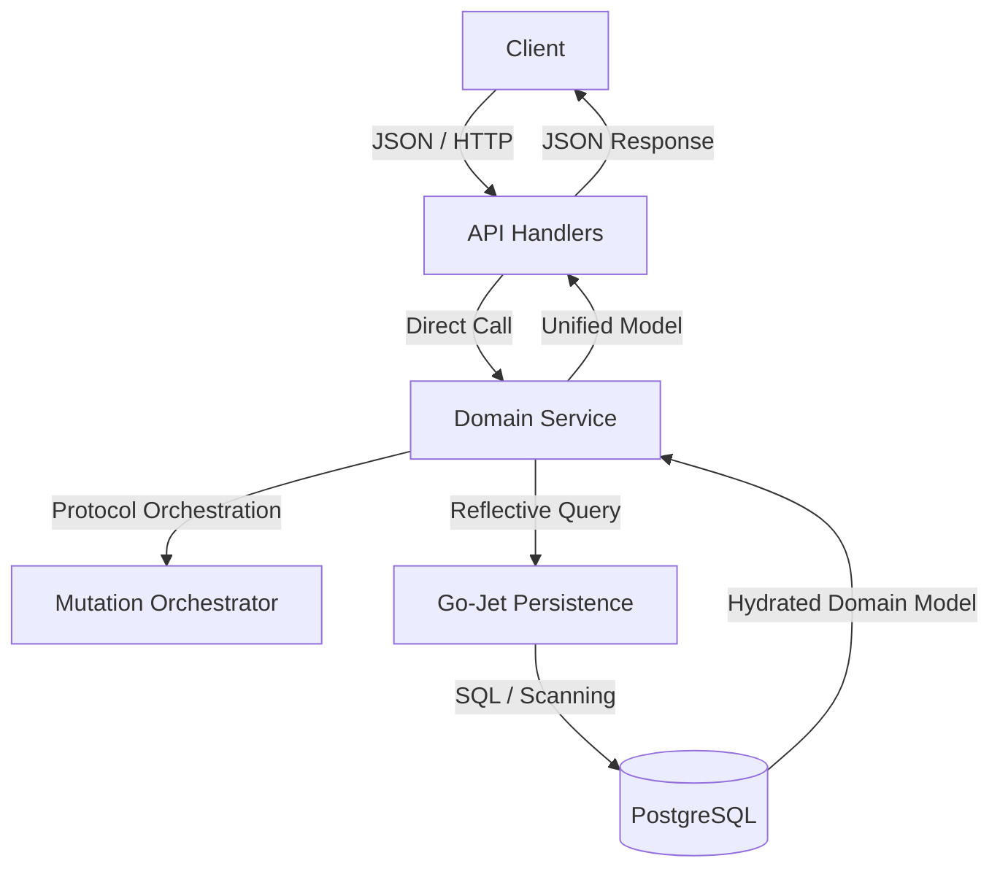

# Layered Architecture Pattern (Go-Native)

The Go-native backend follows a **Services Pattern**. This design minimizes internal mapping overhead by utilizing **Unified Domain Models** while maintaining strict consistency via **Domain Services** and a centralized **Bitemporal Mutation Protocol**.

## Architecture Overview

## Layer Responsibilities

### 1. API Layer (Handlers)
- **Responsibility**: Translates HTTP requests into domain service calls.
- **Validation**: Performs basic syntax and presence validation (e.g., checking for required fields in JSON).
- **Communication**: Calls the appropriate **Domain Service** directly. 
- **Data**: Uses the **Unified Domain Model** for both input (request body) and output (response body) wherever possible.

### 2. Domain Service Layer
- **Responsibility**: The "brain" of the application. Enforces business rules, namespace scoping, and temporal integrity.
- **Protocol**: Executes the **Flush, Purge, and Assert** pipeline:
    1. **Acquire Advisory Lock**: Lock the logical entity ID to serialize mutations.
    2. **Staleness Check**: Re-read the current state under the lock. Compare caller metadata with database state to prevent lost updates.
    3. **Compute New Splinters**: **EBM** calculates the prefix, new assertion, and suffix versions in Go and emits whichever SQL statements most efficiently express them. Callers provide only the new-assertion `INSERT` statements via the builder callback. See [`database_design.md` §7](../architecture/database_design.md) for the bitemporal-honesty invariants this step preserves.
    4. **Flush**: Archive superseded records into the historical partition.
    5. **Purge**: Remove the original records from the active partition.
    6. **Assert**: Insert the new splinters into the active partition.
    7. **Commit Transaction**: Release lock on completion.
  The Flush, Purge, and Assert sub-pipeline is specified in [`database_design.md` §7](../architecture/database_design.md).
- **Integrity**: Ensures that bitemporal validity ranges (`validity_start`, `validity_end`) and transactional metadata are correctly managed.

### 3. Persistence & Infrastructure Layer
- **Responsibility**: Type-safe query construction, reflective data hydration, and bitemporal orchestration.
- **Mechanism**: Utilizes **Go-Jet** table and column metadata to build queries. Uses Go-Jet's reflection engine to scan result rows directly into the hand-authored Unified Model structs.
- **Efficiency**: Eliminates the "Repository" layer by allowing Services to query and hydrate domain objects directly via the infrastructure layer.

## Model Strategy: Unified Domain Models

Unlike the legacy Python architecture, we do **not** use separate models for each layer.

| File Location | Purpose | Metadata Tags |
| :--- | :--- | :--- |
| `src/backend/domain/*.go` | Unified Entity Representation | `json:"..."` plus rare `alias:"<table>[.<column>]"` escape hatches |

### Rules for Modeling:
1.  **Single Source of Truth**: A struct defined in the `domain` package is the only representation of that entity used across the entire backend.
2.  **Reflective Mapping and API Tags**: Struct fields must include `json` tags for API serialization. Go-Jet mapping relies on type and field names that normalize to table and column names; use `alias:"<table>[.<column>]"` only when naming discipline cannot express the mapping.
3.  **No DTOs**: Do not create DTOs for simple CRUD. Only use DTOs if the API representation is fundamentally different from the database schema (e.g., a complex aggregated report). Prefer optional, client-only, service-only, or database-only fields in the Unified Model over DTOs.

## Inter-Layer Communication Protocol

1.  **API to Service**: Pass the Unified Model or primitive technical keys.
2.  **Service to Persistence**: Use Go-Jet to fetch/write the Unified Model.
3.  **Mutation Orchestration**: Every mutation MUST pass through `ExecuteBitemporalMutation (EBM)` (Story 043) to guarantee bitemporal consistency.

## Benefits of the Collapsed Architecture
- **Velocity**: Adding a new field requires updating exactly one struct and the SQL schema.
- **Type Safety**: Go-Jet ensures that queries match the schema at compile-time.
- **Integrity**: Centralizing bitemporal logic in the Service layer prevents "versioning leaks" where developers forget to close ranges or acquire locks.
- **Maintainability**: Clear, flat structure in the `domain` package makes navigation intuitive for both humans and AI agents.
