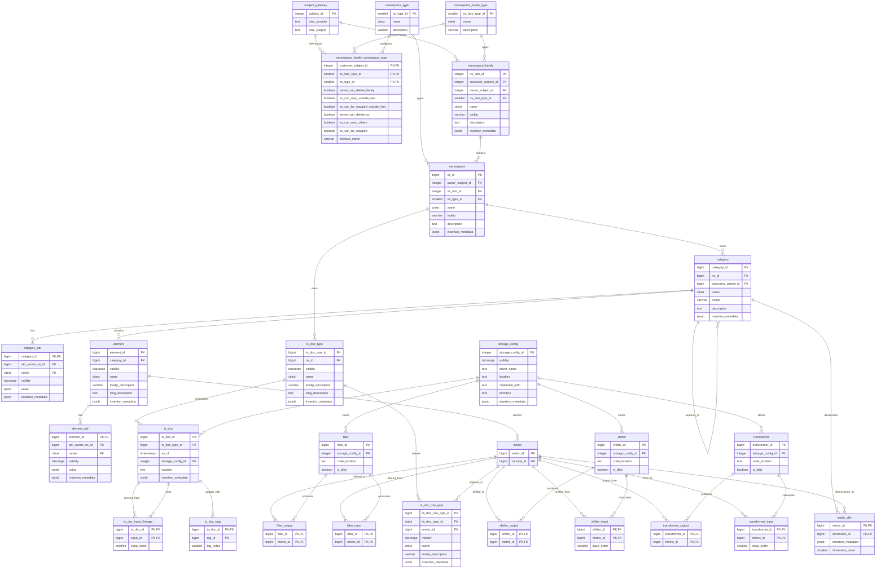

# ChronoCone v0 Data Storage

## Introduction

ChronoCone uses a two-tier storage architecture that separates metadata from time series data. This design reflects the fundamentally different access patterns and scalability requirements of these two types of data.

**PostgreSQL Database**: Stores metadata, configuration, and lineage information. This data is highly relational, requires transactional consistency, and benefits from complex queries with joins and filters.

**Object Store**: Stores time series data files in Parquet format and Python function files (transformers, shifters, and filters). Time series data is accessed in bulk (entire documents at a time), benefits from columnar storage compression, and needs to scale efficiently as data volumes grow. Function files are stored as Python code, enabling versioning, audit trails, and the ability to retrieve the exact code used for historical calculations.

This separation provides several key benefits:

- **Scalability**: Time series data can grow independently of metadata, and object stores like S3 can handle petabyte-scale data efficiently.
- **Query Performance**: PostgreSQL excels at complex relational queries on metadata, while Parquet's columnar format optimizes analytical queries on time series data.
- **Cost Optimization**: Object storage is significantly cheaper than database storage for large volumes of data, and Parquet's compression reduces storage costs further.
- **Access Patterns**: Clients can retrieve entire plan documents via presigned URLs in cloud deployments, avoiding the need to stream data through service interfaces.

---

## Object Store

### Connectors

Connectors represent connections to data sources or sinks in ChronoCone. Each connector has a **driver**, which is a named plugin that implements the logic to access a specific type of data source or sink. This abstraction layer is essential for the system's flexibility: by defining a standard interface for data access, ChronoCone can work with many different storage systems without requiring changes to the core logic.

#### Connector Purposes

ChronoCone uses connectors for two distinct purposes, each addressing different aspects of data management.

**External Service Connectors** access external services from which time series data is pulled or to which time series data is pushed. These connectors interface with external APIs, databases, or other systems that provide or consume time series data. For example, an external service connector might pull demand forecasts from a forecasting system, retrieve inventory levels from a warehouse management system, or push labor schedules to a scheduling system. These connectors handle the translation between ChronoCone's internal data formats and the formats used by external systems.

**Object Store Connectors** access object stores such as local filesystems or cloud object stores (e.g., AWS S3). These connectors are used to store the actual time series data files that ChronoCone produces and manages. The object store abstraction allows the system to work with local files during development and testing, then seamlessly transition to cloud storage for production deployments.

#### Storage Configuration

The [`storage_config`](../../../src/backend/schema/connectors/connectors.sql:4) table defines connector configurations. This table captures all the information needed to establish a connection to a data source or sink:

| Column              | Purpose                                                   |
| ------------------- | --------------------------------------------------------- |
| `storage_config_id` | Unique identifier for the configuration                   |
| `driver_name`       | Named plugin to use (e.g., "local", "s3")                 |
| `location`          | Base path or bucket name for the storage                  |
| `credential_path`   | Path to credentials for accessing the storage             |
| `direction`         | 'I' (input only), 'O' (output only), or 'IO' (read/write) |

The `direction` column is particularly important for understanding data flow. An input-only connector can only read data, which is appropriate for external systems that provide reference data. An output-only connector can only write data, suitable for archiving or reporting systems. A read/write connector can do both, which is the typical configuration for the object stores that hold ChronoCone's working data.

#### v0 Implementation

For the v0 release, only a "local" driver is supported, which provides access to the local filesystem. This driver has a direction of 'IO' since ChronoCone both reads from and writes to this storage. Time series data files are stored in this local datastore. This simple configuration is sufficient for development, testing, and demonstration purposes. The connector abstraction ensures that when the system is ready to move to cloud storage, the change will require only configuration updates and a new driver implementation, not changes to the code that uses the connector.

### Time Series Data Storage

Time series documents reference their storage location through two fields that work together. The [`ts_doc.storage_config_id`](../../../src/backend/schema/timeseries/timeseries.sql:48) references the `storage_config` defining the base storage location, while [`ts_doc.location`](../../../src/backend/schema/timeseries/timeseries.sql:49) specifies the specific file path within that storage. The combination of `storage_config.location` (base path) and `ts_doc.location` (relative path) provides the full path to the time series data file.

This two-part addressing scheme serves an important purpose: it allows the same document metadata to work across different environments. A document created in a development environment might reference a local filesystem, while the same document structure in production would reference cloud storage. The relative path remains the same; only the storage configuration changes.

#### Parquet File Format

Time series data files are stored in **Parquet format**, a columnar storage format optimized for big data processing. The choice of Parquet reflects the nature of time series data and how it is typically accessed. Time series queries often select specific columns (for example, retrieving only forecast values without actuals) or filter by time ranges. Parquet's columnar storage means that queries only read the columns they need, dramatically reducing I/O for these common access patterns.

Parquet provides several advantages for time series data:

- **Columnar Storage**: Allows reading only the columns of interest, reducing I/O for analytical queries.
- **Compression**: Built-in support for compression algorithms (e.g., Snappy, GZIP) reduces storage costs while maintaining fast access.
- **Predicate Pushdown**: Statistics stored in metadata enable predicate pushdown, allowing the system to skip irrelevant row groups without reading them.
- **Partitioning**: Data can be partitioned by directory structure for efficient filtering, which is particularly useful for time-based partitioning.
- **Ecosystem Compatibility**: Parquet's wide ecosystem ensures compatibility with many data processing tools including Pandas, Dask, and Spark.

#### fastparquet Library

ChronoCone uses the **fastparquet** Python package to read and write Parquet files. fastparquet is a pure-Python implementation that provides direct integration with Pandas DataFrames, which is essential for the data manipulation patterns used in transformers and shifters. Unlike PySpark, fastparquet has no Java dependencies, keeping the deployment simple. It supports reading and writing partitioned datasets, and integrates with fsspec for various filesystem backends (local, S3, etc.), which aligns with ChronoCone's connector abstraction.

For detailed API documentation, see the [fastparquet documentation](../../../resources/apis/fastparquet/overview.md).

### Time Series Object Data Format

Each Parquet file stores an entire plan document, which may contain multiple metrics with their associated time series data. The format consists of two components: the table data and custom metadata. This dual structure reflects a fundamental principle of the design: keep the data in a form that is efficient for processing while storing the structural information needed to interpret it correctly.

The decision to store entire plans in single Parquet files rather than individual files per metric is driven by several performance and architectural considerations. Cloud-based object stores such as AWS S3 are highly optimized for fast and efficient I/O operations on individual objects. By storing a complete plan in one file, the system can leverage mechanisms like presigned URLs to provide clients with direct, secure access to the data without routing it through service interfaces. This approach delivers better throughput and performance than serializing data into JSON or other intermediate formats for transmission through a service layer. While the v0 local filesystem implementation does not provide the security guarantees of cloud-based mechanisms, the architecture is designed for production environments where cloud storage with proper access controls would be used.

An alternative approach—storing each individual metric in its own object or file—would result in a chatty interface with many small objects. This granularity would introduce potentially large time overheads in assembling plans, as each metric would require a separate retrieval operation. For a plan with dozens of metrics, this could mean dozens of round trips to the object store before the plan could be fully loaded. By consolidating all metrics for a plan into a single file, the system minimizes retrieval overhead and ensures that plan loading remains efficient regardless of how many metrics the plan contains.

#### Custom Metadata Schema

The Parquet file's custom metadata contains a JSON string with structural information about the metrics in the file. This metadata enables efficient parsing and validation of the table data. Without this metadata, a reader would need to infer the structure from the data itself, which could lead to ambiguity or errors. By explicitly recording the expected structure, the system can validate data as it is read and provide clear error messages when something is wrong.

The custom metadata includes the following information for each metric:

| Field             | Description                                                                                    |
| ----------------- | ---------------------------------------------------------------------------------------------- |
| `metric_name`     | The unique name of the metric                                                                  |
| `dimension_names` | Ordered list of dimension names that index the metric (e.g., `["region", "product_category"]`) |
| `dimension_types` | Ordered list of data types for each dimension, parallel to `dimension_names`                   |
| `time_grain`      | The time grain of the metric (e.g., "daily", "weekly", "monthly")                              |
| `forecast_length` | The number of periods in the forecast horizon                                                  |
| `data_types`      | List of data type(s) for the metric values (e.g., `["number"]` or `["number", "currency"]`)    |

The `dimension_names` and `dimension_types` fields work together to define how the metric is indexed. A metric might be indexed by region and product category, for example, meaning that each unique combination of region and category has its own time series. The order of these dimensions matters because it determines how the data is organized in the in-memory representation.

**Example Custom Metadata:**

```json
{
  "metrics": {
    "sales_units": {
      "dimension_names": ["region", "product_category"],
      "dimension_types": ["string", "string"],
      "time_grain": "weekly",
      "forecast_length": 13,
      "data_types": ["number"]
    },
    "revenue": {
      "dimension_names": ["region", "product_category"],
      "dimension_types": ["string", "string"],
      "time_grain": "weekly",
      "forecast_length": 13,
      "data_types": ["currency_usd"]
    }
  },
  "dimension_order": ["region", "product_category"]
}
```

The `dimension_order` field at the top level captures the canonical order of dimensions for the plan document, ensuring consistent key sequences when building the in-memory representation.

#### Table Schema

The Parquet table contains the actual time series data with the following columns. This schema is designed to accommodate multiple metrics with different dimensional structures within a single file, which is essential for representing complete plan documents.

| Column Name        | Data Type    | Description                                                                                                          |
| ------------------ | ------------ | -------------------------------------------------------------------------------------------------------------------- |
| `metric_name`      | STRING       | The name of the metric this data point belongs to                                                                    |
| `dimension_values` | LIST<STRING> | Ordered list of dimension values, parallel to the `dimension_names` in metadata                                      |
| `data_type`        | STRING       | Either "FORECAST" or "ACTUALS" to designate the nature of the data point                                             |
| `timestamp`        | TIMESTAMP    | The timestamp of the data point                                                                                      |
| `value`            | STRING       | JSON-encoded value (supports multi-valued metrics, e.g., `{"value": 100.0}` or `{"units": 100, "revenue": 5000.00}`) |

The `value` column uses JSON encoding to support multi-valued metrics. Some metrics produce multiple related values for each time point—for example, a forecast might include both a point estimate and confidence intervals, or a labor metric might include both headcount and hours. By encoding values as JSON, the schema can accommodate these variations without requiring schema changes for each new metric type.

**Example Table Data:**

| metric_name | dimension_values        | data_type | timestamp           | value                  |
| ----------- | ----------------------- | --------- | ------------------- | ---------------------- |
| sales_units | ["West", "Electronics"] | FORECAST  | 2024-01-01T00:00:00 | `{"value": 1500}`      |
| sales_units | ["West", "Electronics"] | ACTUALS   | 2024-01-01T00:00:00 | `{"value": 1475}`      |
| sales_units | ["East", "Electronics"] | FORECAST  | 2024-01-01T00:00:00 | `{"value": 2000}`      |
| revenue     | ["West", "Electronics"] | FORECAST  | 2024-01-01T00:00:00 | `{"value": 150000.00}` |

#### In-Memory Representation

When a time series object is loaded from storage, it is converted to an in-memory representation as a multi-level dictionary. This structure provides efficient access to individual data points while preserving the hierarchical organization of the data. The nested dictionary structure mirrors how planners typically think about metrics: first selecting which metric to examine, then drilling down through dimensional values to find the specific time series of interest.

**Key Sequence:**

```
Metric Name → Dimension Value(s) → Forecast/Actuals → Timestamp → Value
```

This key sequence determines how the dictionary is traversed. Starting with a metric name, you navigate through dimension values in the order specified by `dimension_order`, then select whether you want forecast or actuals data, and finally access values by timestamp. This structure makes common operations like retrieving all forecasts for a particular dimensional combination straightforward and efficient.

**Structure:**

```python
{
    "dimension_order": ["region", "product_category"],  # List attribute capturing dimension order
    "metrics": {
        "sales_units": {
            "West": {
                "Electronics": {
                    "FORECAST": {
                        datetime(2024, 1, 1): {"value": 1500},
                        datetime(2024, 1, 8): {"value": 1600},
                        # ... more timestamps
                    },
                    "ACTUALS": {
                        datetime(2024, 1, 1): {"value": 1475},
                        # ... more timestamps
                    }
                },
                "Apparel": {
                    # ... similar structure
                }
            },
            "East": {
                # ... similar structure
            }
        },
        "revenue": {
            # ... similar structure
        }
    }
}
```

The `dimension_order` attribute ensures that the dimension keys are traversed in the correct order when building or querying the dictionary. Each level of dimension nesting corresponds to one dimension name in the `dimension_order` list. This explicit ordering is necessary because dictionary iteration order, while deterministic in Python 3.7+, reflects insertion order rather than any logical ordering. By recording the intended order in metadata, the system can correctly reconstruct the dimensional hierarchy regardless of how the data was originally serialized.

#### StorageInterface Caching

Multiple documents in the database may reference the same Parquet file in the object store. This situation arises when different views or subsets of the same underlying data are used for different purposes. To avoid redundant reads, the `StorageInterface` (see [Story013](../../stories/Story013_storage-interface.md)) is responsible for caching loaded objects.

When a time series object is requested, the `StorageInterface` first checks its internal cache using the storage location as the key. If the object is in the cache, it returns the cached in-memory representation immediately. If not cached, it reads the Parquet file, parses it into the in-memory representation, caches it, and returns it. This caching mechanism ensures that each Parquet file is read at most once per service instance, regardless of how many documents reference it. The performance impact is significant: reading and parsing a Parquet file is an expensive operation, and avoiding redundant reads can dramatically improve response times for operations that access the same data multiple times.

### Function Storage

All transformer, shifter, and filter functions are stored as Python code in an object store accessed through a connector abstraction. In v0, the connector provides access to the local filesystem. Future versions will support cloud-based object stores such as AWS S3. This storage approach treats calculation logic as data, which enables versioning, audit trails, and the ability to retrieve the exact code that was used for any historical calculation.

Functions are identified by name within a namespace family. A function name must be unique within its namespace family to prevent ambiguity during plan calculation. However, the same name may appear in different namespace families or in different namespaces within the same family. This scoping allows different teams or organizations to develop their own calculation logic without worrying about name collisions, while ensuring that within any given planning context, function names are unambiguous.

#### Test Data Storage

Test data for transformers, shifters, and filters is stored in Parquet format alongside the function code in the object store. This co-location ensures that test data remains synchronized with the specific version of the function it was designed to test.

The test data Parquet files follow a simple schema optimized for the tabular test case format used in the Plugin UI:

| Column Name       | Data Type | Description                                         |
| ----------------- | --------- | --------------------------------------------------- |
| `test_case_id`    | INTEGER   | Unique identifier for the test case within the file |
| `input_values`    | JSON      | JSON-encoded input values for the test case         |
| `expected_output` | JSON      | JSON-encoded expected output value                  |

The JSON encoding for `input_values` and `expected_output` supports the various data types that functions may produce or consume, including numbers, strings, dates, and nested structures. This format allows the Plugin UI to read and write test data efficiently while preserving the flexibility needed for different function signatures.

When a function is pulled from the object store, its associated test data file (if present) is also retrieved. When a modified function is pushed back to the object store, the updated test data accompanies it. This synchronization ensures that the test data always reflects the current state of the function's test suite.

---

## PostgreSQL Database

### Overview

The PostgreSQL database serves as the authoritative source for all metadata in ChronoCone. It stores:

- **Policy**: Namespace organization, access control, and subject identity
- **Taxonomy**: Categories, elements, and their attributes
- **Timeseries**: Document types, documents, and lineage tracking
- **Connectors**: Storage configuration for data access
- **Morphisms**: Metrics, transformers, and their relationships

The database uses a bitemporal validity model for tracking entity versions over time, enabling full audit history and point-in-time queries.

### Schema Organization

The database is organized into five schemas, each addressing a specific domain:

| Schema     | SQL File                                                                                                                                                         | Purpose                                                             |
| ---------- | ---------------------------------------------------------------------------------------------------------------------------------------------------------------- | ------------------------------------------------------------------- |
| policy     | [`policy.sql`](../../../src/backend/schema/policy/policy.sql)                                                                                       | Namespace organization and access control                           |
| taxonomy   | [`taxonomy.sql`](../../../src/backend/schema/taxonomy/taxonomy.sql)                                                                                 | Categories, elements, and attributes                                |
| timeseries | [`timeseries.sql`](../../../src/backend/schema/timeseries/timeseries.sql)                                                                           | Document types, documents, and lineage                              |
| connectors | [`connectors.sql`](../../../src/backend/schema/connectors/connectors.sql)                                                                           | Storage configuration                                               |
| morphisms  | [`transform.sql`](../../../src/backend/schema/morphisms/transform.sql), [`shift.sql`](../../../src/backend/schema/morphisms/shift.sql) | Metrics, transformers, shifters, filters, and data flow definitions |

---

## Bitemporal Validity Model

Many tables in the ChronoCone database include a `validity` column that implements bitemporal versioning. This section explains how validity works and which tables use it.

### What is Bitemporal Validity?

Bitemporal validity tracks when a version of an entity is valid in the real world. The `validity` column uses PostgreSQL's `tstzrange` type, which stores a time range with a lower and upper bound.

**Range Semantics**: The validity range uses `[lower, upper)` notation, meaning:

- Lower bound is **inclusive** (the entity is valid starting at this timestamp)
- Upper bound is **exclusive** (the entity is no longer valid at this timestamp)

**Default Behavior**: When a new row is created, the validity range is typically set from the creation time to infinity, indicating the entity is currently valid with no known end date.

### Close-and-Insert Pattern

Updates to entities with validity columns never modify existing rows in place. Instead, updates follow a "close and insert" pattern:

1. **Close**: Update the existing row's validity upper bound to the current timestamp
2. **Insert**: Create a new row with validity starting at the current timestamp and extending to infinity

This pattern preserves complete history of all entity versions, enabling:

- Point-in-time queries (what did this entity look like at a specific timestamp?)
- Audit trails (what changed and when?)
- Reproducibility (what calculation logic was used for a historical document?)

### Application Constraints

Because validity ranges create temporal versions of entities, standard foreign key constraints cannot always be used. A foreign key constraint would require matching the exact validity range between related rows, but in practice, we want to allow relationships where the validity ranges overlap rather than match exactly.

These "application constraints" are defined in the schema files using PostgreSQL's exclusion constraints or custom constraint syntax, and are enforced by the database. For example:

```sql
APPLICATION CONSTRAINT  (ns_id, validity) -> namespace(ns_id, validity)
```

This indicates that the `ns_id` column references the `namespace` table, and the validity ranges should overlap, but this cannot be expressed as a standard database foreign key. These constraints are currently commented out in the schema files because they reference validity columns that are temporarily disabled pending design decisions (see [Story011 - Validity Field Implementation](../../stories/Story011_validity-field-implementation.md)). When the validity columns are enabled, these constraints will be uncommented and enforced.

### Tables with Validity

| Table                | Validity Enabled | Notes                                  |
| -------------------- | ---------------- | -------------------------------------- |
| `storage_config`     | Yes              | Tracks storage configuration versions  |
| `category`           | Disabled         | Commented out pending design decisions |
| `category_attr`      | Yes              | Category attribute versions            |
| `element`            | Yes              | Element versions                       |
| `element_attr`       | Yes              | Element attribute versions             |
| `namespace_family`   | Disabled         | Commented out pending design decisions |
| `namespace`          | Disabled         | Commented out pending design decisions |
| `ts_doc_type`        | Yes              | Document type versions                 |
| `ts_doc_row_type`    | Yes              | Document row type versions             |
| `metric`             | Disabled         | Commented out in schema                |
| `metric_dim`         | Disabled         | Commented out in schema                |
| `transformer`        | Disabled         | Commented out in schema                |
| `transformer_input`  | Disabled         | Commented out in schema                |
| `transformer_output` | Disabled         | Commented out in schema                |
| `shifter`            | Disabled         | Commented out in schema                |
| `shifter_input`      | Disabled         | Commented out in schema                |
| `shifter_output`     | Disabled         | Commented out in schema                |
| `filter`             | Disabled         | Commented out in schema                |
| `filter_input`       | Disabled         | Commented out in schema                |
| `filter_output`      | Disabled         | Commented out in schema                |

---

## Entity-Relationship Diagram

The following ER diagram shows all tables in the ChronoCone database, their columns with data types, and the relationships between them.



---

## Table Documentation

### Policy Schema

The policy schema manages namespace organization, access control, and subject identity. It defines how the system is organized into isolated computation contexts and who has access to them.

#### namespace_family_type

Enumeration of namespace family types. This table is seeded with initial values.

| Column         | Type     | Description                    |
| -------------- | -------- | ------------------------------ |
| ns_fam_type_id | smallint | Primary key                    |
| name           | citext   | Unique name of the family type |
| description    | varchar  | Description of the family type |

**Seeded Values**:

- `1`: application - Application-level namespace families
- `2`: personal - Personal namespace families for individual users
- `3`: team - Team namespace families for collaborative work

#### namespace_type

Enumeration of namespace types representing different environments or purposes. This table is seeded with initial values.

| Column      | Type     | Description                       |
| ----------- | -------- | --------------------------------- |
| ns_type_id  | smallint | Primary key                       |
| name        | citext   | Unique name of the namespace type |
| description | varchar  | Description of the namespace type |

**Seeded Values**:

- `1`: Production - Plan-of-record environment
- `2`: Smoke Test - Deployment smoke test environment
- `3`: Integration - Deployment integration test environment
- `4`: UAT - User acceptance test environment
- `5`: Alpha - Developer alpha environment
- `6`: Scenario - Scenario planning environment
- `7`: Experiment - Experimental sandbox environment
- `8`: Beta - Public beta environment

#### subject_gateway

Maps OIDC (OpenID Connect) identities to internal subject IDs. This table provides a stable internal identifier for users regardless of their authentication provider.

| Column        | Type    | Description                                     |
| ------------- | ------- | ----------------------------------------------- |
| subject_id    | integer | Primary key, auto-generated                     |
| oidc_provider | text    | The OIDC provider name                          |
| oidc_subject  | text    | The subject identifier within the OIDC provider |

**Seeded Values**:

- `-1`: System default subject with empty provider and "nobody" subject

#### namespace_family_namespace_type

Junction table defining allowed combinations of namespace family types and namespace types, along with the capabilities each combination provides.

| Column                       | Type     | Description                                       |
| ---------------------------- | -------- | ------------------------------------------------- |
| customer_subject_id          | integer  | FK to subject_gateway, part of composite PK       |
| ns_fam_type_id               | smallint | FK to namespace_family_type, part of composite PK |
| ns_type_id                   | smallint | FK to namespace_type, part of composite PK        |
| owner_can_delete_family      | boolean  | Whether owner can delete the namespace family     |
| ns_can_map_outside_fam       | boolean  | Whether namespaces can map to outside the family  |
| ns_can_be_mapped_outside_fam | boolean  | Whether namespaces can be mapped from outside     |
| owner_can_delete_ns          | boolean  | Whether owner can delete namespaces               |
| ns_can_map_others            | boolean  | Whether namespaces can map to other namespaces    |
| ns_can_be_mapped             | boolean  | Whether namespaces can be mapped by others        |
| shortcut_name                | varchar  | Human-readable description of the combination     |

#### namespace_family

Top-level grouping of namespaces owned by a customer. Namespace families provide isolation between different organizational units or purposes.

| Column              | Type     | Description                                  |
| ------------------- | -------- | -------------------------------------------- |
| ns_fam_id           | integer  | Primary key, auto-generated                  |
| customer_subject_id | integer  | FK to subject_gateway, the customer owner    |
| owner_subject_id    | integer  | FK to subject_gateway, the operational owner |
| ns_fam_type_id      | smallint | FK to namespace_family_type                  |
| name                | citext   | Unique name within customer scope            |
| tooltip             | varchar  | Short description for UI tooltips            |
| description         | text     | Full description of the namespace family     |
| insertion_metadata  | jsonb    | Metadata about row creation                  |

**Note**: Validity column is currently disabled pending design decisions.

#### namespace

An isolated computation context within a namespace family. Namespaces provide separation between different environments (e.g., production, testing, development).

| Column             | Type     | Description                                |
| ------------------ | -------- | ------------------------------------------ |
| ns_id              | bigint   | Primary key, auto-generated                |
| owner_subject_id   | integer  | FK to subject_gateway, the namespace owner |
| ns_fam_id          | integer  | FK to namespace_family                     |
| ns_type_id         | smallint | FK to namespace_type                       |
| name               | citext   | Unique name within namespace family        |
| tooltip            | varchar  | Short description for UI tooltips          |
| description        | text     | Full description of the namespace          |
| insertion_metadata | jsonb    | Metadata about row creation                |

**Note**: Validity column is currently disabled pending design decisions.

---

### Taxonomy Schema

The taxonomy schema defines categories and elements, which are the building blocks for dimensions and metrics. Categories group related elements, and elements represent specific dimension values.

#### category

Groups of related elements that define dimensions. Categories can be hierarchical through the `taxonomy_parent_id` field.

| Column             | Type    | Description                                |
| ------------------ | ------- | ------------------------------------------ |
| category_id        | bigint  | Primary key, auto-generated                |
| ns_id              | bigint  | FK to namespace, owner of this category    |
| taxonomy_parent_id | bigint  | FK to element, for hierarchical categories |
| name               | citext  | Unique name within namespace               |
| tooltip            | varchar | Short description for UI tooltips          |
| description        | text    | Full description of the category           |
| insertion_metadata | jsonb   | Metadata about row creation                |

**Note**: Validity column is currently disabled pending design decisions.

#### category_attr

Custom attributes on categories. Attributes are owned by a namespace (which may differ from the category's namespace) and can store arbitrary JSON data.

| Column             | Type      | Description                                     |
| ------------------ | --------- | ----------------------------------------------- |
| category_id        | bigint    | FK to category, part of composite PK            |
| attr_owner_ns_id   | bigint    | Namespace that owns this attribute, part of PK  |
| name               | citext    | Attribute name, part of composite PK            |
| validity           | tstzrange | Time range when this attribute version is valid |
| value              | jsonb     | The attribute value                             |
| insertion_metadata | jsonb     | Metadata about row creation                     |

#### element

Individual dimension values within a category. Elements can serve as taxonomy parents for sub-categories, enabling hierarchical taxonomies.

| Column              | Type      | Description                                   |
| ------------------- | --------- | --------------------------------------------- |
| element_id          | bigint    | Primary key, auto-generated                   |
| category_id         | bigint    | FK to category, parent category               |
| validity            | tstzrange | Time range when this element version is valid |
| name                | citext    | Unique name within category                   |
| tooltip_description | varchar   | Short description for UI tooltips             |
| long_description    | text      | Full description of the element               |
| insertion_metadata  | jsonb     | Metadata about row creation                   |

#### element_attr

Custom attributes on elements. Like category attributes, these are owned by a namespace and can store arbitrary JSON data.

| Column             | Type      | Description                                     |
| ------------------ | --------- | ----------------------------------------------- |
| element_id         | bigint    | FK to element, part of composite PK             |
| attr_owner_ns_id   | bigint    | Namespace that owns this attribute, part of PK  |
| name               | citext    | Attribute name, part of composite PK            |
| validity           | tstzrange | Time range when this attribute version is valid |
| value              | jsonb     | The attribute value                             |
| insertion_metadata | jsonb     | Metadata about row creation                     |

---

### Timeseries Schema

The timeseries schema defines document types (templates for plans) and documents (actual plan instances), along with lineage tracking for data derivation.

#### ts_doc_type

Document type definitions that serve as templates for plans. Each document type defines the structure and metrics that appear in documents of that type.

| Column              | Type      | Description                                  |
| ------------------- | --------- | -------------------------------------------- |
| ts_doc_type_id      | bigint    | Primary key, auto-generated                  |
| ns_id               | bigint    | FK to namespace, owner of this document type |
| validity            | tstzrange | Time range when this version is valid        |
| name                | citext    | Unique name within namespace                 |
| tooltip_description | varchar   | Short description for UI tooltips            |
| long_description    | text      | Full description of the document type        |
| insertion_metadata  | jsonb     | Metadata about row creation                  |

#### ts_doc_row_type

Metric definitions within a document type. Each row type specifies a metric that appears in documents of the parent type.

| Column              | Type      | Description                                   |
| ------------------- | --------- | --------------------------------------------- |
| ts_doc_row_type_id  | bigint    | Primary key, auto-generated                   |
| ts_doc_type_id      | bigint    | FK to ts_doc_type, parent document type       |
| metric_id           | bigint    | FK to metric, the metric definition           |
| validity            | tstzrange | Time range when this version is valid         |
| name                | citext    | Name of the row type within the document type |
| tooltip_description | varchar   | Short description for UI tooltips             |
| insertion_metadata  | jsonb     | Metadata about row creation                   |

#### ts_doc

Actual document instances. Each document is an instance of a document type at a specific point in time, with its data stored in an object store.

| Column             | Type        | Description                                 |
| ------------------ | ----------- | ------------------------------------------- |
| ts_doc_id          | bigint      | Primary key, auto-generated                 |
| ts_doc_type_id     | bigint      | FK to ts_doc_type, the document type        |
| as_of              | timestamptz | The point in time this document represents  |
| storage_config_id  | integer     | FK to storage_config, base storage location |
| location           | text        | Relative path to the Parquet file           |
| insertion_metadata | jsonb       | Metadata about row creation                 |

#### ts_doc_tags

Tags for document categorization and filtering. Tags reference elements from categories, enabling flexible document organization.

| Column    | Type     | Description                                  |
| --------- | -------- | -------------------------------------------- |
| ts_doc_id | bigint   | FK to ts_doc, part of composite PK           |
| tag_id    | bigint   | FK to element, the tag value, part of PK     |
| tag_index | smallint | Index for ordering tags, unique per document |

#### ts_doc_input_lineage

Tracks document derivation and ancestry. Records which documents were used as inputs to create this document, enabling full data lineage.

| Column      | Type     | Description                                    |
| ----------- | -------- | ---------------------------------------------- |
| ts_doc_id   | bigint   | FK to ts_doc, the output document, part of PK  |
| input_id    | bigint   | FK to ts_doc, the input document, part of PK   |
| input_index | smallint | Index for ordering inputs, unique per document |

---

### Connectors Schema

The connectors schema defines storage configurations for accessing data sources and sinks.

#### storage_config

Configuration for connecting to data sources or sinks. Each configuration specifies a driver, location, credentials, and access direction.

| Column             | Type      | Description                                         |
| ------------------ | --------- | --------------------------------------------------- |
| storage_config_id  | integer   | Primary key, auto-generated                         |
| validity           | tstzrange | Time range when this configuration version is valid |
| driver_name        | text      | Named plugin to use (e.g., "local", "s3")           |
| location           | text      | Base path or bucket name for the storage            |
| credential_path    | text      | Path to credentials for accessing the storage       |
| direction          | text      | 'I' (input), 'O' (output), or 'IO' (read/write)     |
| insertion_metadata | jsonb     | Metadata about row creation                         |

---

### Morphisms Schema

The morphisms schema defines metrics, transformers, and their relationships. This schema captures the computational graph that transforms input data into output metrics.

#### metric

Links a concept (element) to its computational definition. A metric represents a measurable quantity that can be calculated from input data.

| Column     | Type   | Description                         |
| ---------- | ------ | ----------------------------------- |
| metric_id  | bigint | Primary key, auto-generated         |
| concept_id | bigint | FK to element, the business concept |

**Note**: Validity column is currently disabled in the schema.

#### metric_dim

Defines the dimensions that index a metric. Each metric can be indexed by multiple categories, enabling multi-dimensional analysis.

| Column             | Type     | Description                                   |
| ------------------ | -------- | --------------------------------------------- |
| metric_id          | bigint   | FK to metric, part of composite PK            |
| dimension_id       | bigint   | FK to category, the dimension, part of PK     |
| insertion_metadata | jsonb    | Metadata about row creation                   |
| dimension_order    | smallint | Order of this dimension in the metric's index |

**Note**: Validity column is currently disabled in the schema.

#### transformer

Python code that transforms input metrics into output metrics. Transformers are stored in the object store and referenced by location.

| Column            | Type    | Description                                                         |
| ----------------- | ------- | ------------------------------------------------------------------- |
| transformer_id    | bigint  | Primary key, auto-generated                                         |
| storage_config_id | integer | FK to storage_config, where code is stored                          |
| code_location     | text    | Relative path to the Python code file                               |
| is_dirty          | boolean | Whether this transformer is unpublished (true) or published (false) |

The `is_dirty` column supports the publishing workflow. When a transformer is pushed from a local workspace, it is stored with `is_dirty` set to `true`, indicating it is unpublished. The calculation engine excludes unpublished transformers from production calculations. When the transformer is published through the admin endpoint, `is_dirty` is set to `false`, making it available for production use.

**Note**: Validity column is currently disabled in the schema.

#### transformer_input

Defines the input metrics for a transformer. Each input has an order that determines how it's passed to the transformer function.

| Column         | Type     | Description                                     |
| -------------- | -------- | ----------------------------------------------- |
| transformer_id | bigint   | FK to transformer, part of composite PK         |
| metric_id      | bigint   | FK to metric, the input metric, part of PK      |
| input_order    | smallint | Order of this input in the transformer function |

**Note**: Validity column is currently disabled in the schema.

#### transformer_output

Defines the output metrics produced by a transformer.

| Column         | Type   | Description                                 |
| -------------- | ------ | ------------------------------------------- |
| transformer_id | bigint | FK to transformer, part of composite PK     |
| metric_id      | bigint | FK to metric, the output metric, part of PK |

**Note**: Validity column is currently disabled in the schema.

#### shifter

Python code that transforms a metric with one set of dimensions into a metric with a different set of dimensions. Shifters enable transformers to work with inputs that have incompatible dimensional structures.

| Column            | Type    | Description                                                     |
| ----------------- | ------- | --------------------------------------------------------------- |
| shifter_id        | bigint  | Primary key, auto-generated                                     |
| storage_config_id | integer | FK to storage_config, where code is stored                      |
| code_location     | text    | Relative path to the Python code file                           |
| is_dirty          | boolean | Whether this shifter is unpublished (true) or published (false) |

The `is_dirty` column supports the publishing workflow. When a shifter is pushed from a local workspace, it is stored with `is_dirty` set to `true`, indicating it is unpublished. The calculation engine excludes unpublished shifters from production calculations. When the shifter is published through the admin endpoint, `is_dirty` is set to `false`, making it available for production use.

**Note**: Validity column is currently disabled in the schema.

#### shifter_input

Defines the input metrics for a shifter. Each input has an order that determines how it's passed to the shifter function.

| Column      | Type     | Description                                 |
| ----------- | -------- | ------------------------------------------- |
| shifter_id  | bigint   | FK to shifter, part of composite PK         |
| metric_id   | bigint   | FK to metric, the input metric, part of PK  |
| input_order | smallint | Order of this input in the shifter function |

**Note**: Validity column is currently disabled in the schema.

#### shifter_output

Defines the output metrics produced by a shifter.

| Column     | Type   | Description                                 |
| ---------- | ------ | ------------------------------------------- |
| shifter_id | bigint | FK to shifter, part of composite PK         |
| metric_id  | bigint | FK to metric, the output metric, part of PK |

**Note**: Validity column is currently disabled in the schema.

#### filter

Python code that splits a single input metric into multiple output metrics. The key property of filters is that the values in the input metric equal the sum of the corresponding values in the output metrics.

| Column            | Type    | Description                                                    |
| ----------------- | ------- | -------------------------------------------------------------- |
| filter_id         | bigint  | Primary key, auto-generated                                    |
| storage_config_id | integer | FK to storage_config, where code is stored                     |
| code_location     | text    | Relative path to the Python code file                          |
| is_dirty          | boolean | Whether this filter is unpublished (true) or published (false) |

The `is_dirty` column supports the publishing workflow. When a filter is pushed from a local workspace, it is stored with `is_dirty` set to `true`, indicating it is unpublished. The calculation engine excludes unpublished filters from production calculations. When the filter is published through the admin endpoint, `is_dirty` is set to `false`, making it available for production use.

**Note**: Validity column is currently disabled in the schema.

#### filter_input

Defines the input metric for a filter.

| Column    | Type   | Description                                |
| --------- | ------ | ------------------------------------------ |
| filter_id | bigint | FK to filter, part of composite PK         |
| metric_id | bigint | FK to metric, the input metric, part of PK |

**Note**: Validity column is currently disabled in the schema.

#### filter_output

Defines the output metrics produced by a filter.

| Column    | Type   | Description                                 |
| --------- | ------ | ------------------------------------------- |
| filter_id | bigint | FK to filter, part of composite PK          |
| metric_id | bigint | FK to metric, the output metric, part of PK |

**Note**: Validity column is currently disabled in the schema.

---

## Cross-References

- **SQL Schema Files**: [`src/backend/schema/`](../../../src/backend/schema/)
- **Story014 - SQL Documentation**: [Story014_sql-documentation-and-er-diagram.md](../../stories/Story014_sql-documentation-and-er-diagram.md)
- **Story013 - Storage Interface**: [Story013_storage-interface.md](../../stories/Story013_storage-interface.md)
- **fastparquet API**: [resources/apis/fastparquet/](../../../resources/apis/fastparquet/)
