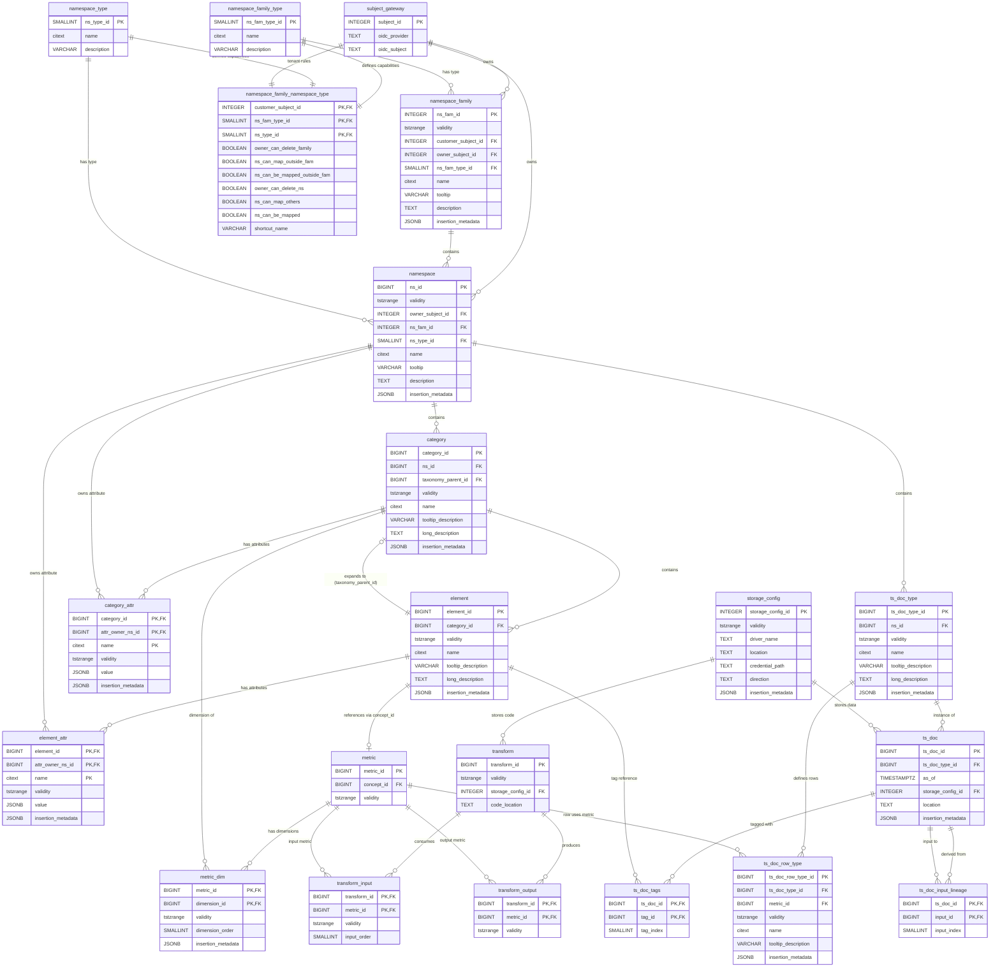

# System Concepts: Database Schema Overview

This document provides a comprehensive overview of the Chronocone database schema, which implements a bitemporal, multi-tenant system for managing hierarchical taxonomies, time series data, data transformations, and access policies.

## Entity Relationship Diagram

## Major Objects and Their Relationships

### Policy Subsystem

The policy subsystem manages multi-tenant access control and namespace organization.

#### [`subject_gateway`](schema/policy/policy.sql:46)

The [`subject_gateway`](schema/policy/policy.sql:46) table represents authenticated users or system actors. It maps external OIDC (OpenID Connect) identities to internal subject identifiers. A special subject with `subject_id = -1` represents a system default actor ("nobody").

**Relationships:**

- A subject can own multiple [`namespace_family`](schema/policy/policy.sql:98) instances (as customer or individual owner)
- A subject can own multiple [`namespace`](schema/policy/policy.sql:119) instances
- A subject defines tenant-specific policy rules via [`namespace_family_namespace_type`](schema/policy/policy.sql:61)

#### [`namespace_family`](schema/policy/policy.sql:98)

A [`namespace_family`](schema/policy/policy.sql:98) groups related namespaces under a common owner and type. Families can be application-level (e.g., production, testing), personal (e.g., sandboxes), or team-based (collaborative environments).

**Relationships:**

- Owned by a [`subject_gateway`](schema/policy/policy.sql:46) (both customer and individual owner)
- Contains multiple [`namespace`](schema/policy/policy.sql:119) instances
- Has a [`namespace_family_type`](schema/policy/policy.sql:4) (application, personal, or team)
- Works with [`namespace_family_namespace_type`](schema/policy/policy.sql:61) to define capabilities

#### [`namespace`](schema/policy/policy.sql:119)

Namespaces provide isolation boundaries for taxonomies, metrics, and time series data. Each namespace has a type (e.g., Production, Alpha, Experiment) that determines its capabilities through policy rules.

**Relationships:**

- Belongs to exactly one [`namespace_family`](schema/policy/policy.sql:98)
- Owned by a [`subject_gateway`](schema/policy/policy.sql:46)
- Has a [`namespace_type`](schema/policy/policy.sql:19) that defines its lifecycle stage
- Contains [`category`](schema/taxonomy/taxonomy.sql:13) instances (taxonomy root elements)
- Contains [`ts_doc_type`](schema/timeseries/timeseries.sql:4) instances (time series document definitions)
- Can own attributes on [`category_attr`](schema/taxonomy/taxonomy.sql:37) and [`element_attr`](schema/taxonomy/taxonomy.sql:74) even outside its own namespace

#### [`namespace_family_namespace_type`](schema/policy/policy.sql:61)

This junction table defines the policy capabilities for combinations of family types and namespace types. It controls permissions such as whether an owner can delete a family, whether a namespace can map resources outside its family, and whether resources can be shared.

**Relationships:**

- References a [`subject_gateway`](schema/policy/policy.sql:46) (typically the system default for global policies)
- References a [`namespace_family_type`](schema/policy/policy.sql:4)
- References a [`namespace_type`](schema/policy/policy.sql:19)
- Defines behavioral rules for the combination of these three dimensions

### Taxonomy Subsystem

The taxonomy subsystem implements hierarchical classification structures with cross-namespace attribute support.

#### [`category`](schema/taxonomy/taxonomy.sql:13)

A [`category`](schema/taxonomy/taxonomy.sql:13) defines a classification dimension or grouping. Categories can form hierarchies where a category can expand another element (via [`taxonomy_parent_id`](schema/taxonomy/taxonomy.sql:16)), allowing rich taxonomic structures.

Categories are dimensions associated with metric. For
example, in a demand forecast metric that was broken
out by cost, type of promise (e.g., 1 day, 2 day) and 
geographical location the cost, promise and location dimensions are each categories.

**Relationships:**

- Belongs to exactly one [`namespace`](schema/policy/policy.sql:119)
- Contains multiple [`element`](schema/taxonomy/taxonomy.sql:54) instances
- Can expand from an [`element`](schema/taxonomy/taxonomy.sql:54) (via [`taxonomy_parent_id`](schema/taxonomy/taxonomy.sql:16)), enabling hierarchical taxonomies
- Has zero or more [`category_attr`](schema/taxonomy/taxonomy.sql:37) attributes
- Serves as a dimension for [`metric_dim`](schema/morphisms/transform.sql:16)

#### [`element`](schema/taxonomy/taxonomy.sql:54)

An [`element`](schema/taxonomy/taxonomy.sql:54) represents a specific member within a category. Elements are the leaf nodes for classification—the actual values that can be used to tag data or define dimensions.

**Relationships:**

- Belongs to exactly one [`category`](schema/taxonomy/taxonomy.sql:13)
- Can serve as a [`taxonomy_parent_id`](schema/taxonomy/taxonomy.sql:16) for another [`category`](schema/taxonomy/taxonomy.sql:13), enabling taxonomy expansion
- Can be referenced as a concept by [`metric`](schema/morphisms/transform.sql:4) (via `concept_id`)
- Used as tags on [`ts_doc_tags`](schema/timeseries/timeseries.sql:58)
- Has zero or more [`element_attr`](schema/taxonomy/taxonomy.sql:74) attributes

#### [`category_attr`](schema/taxonomy/taxonomy.sql:37) and [`element_attr`](schema/taxonomy/taxonomy.sql:74)

These tables store flexible JSONB attributes on categories and elements. The [`attr_owner_ns_id`](schema/taxonomy/taxonomy.sql:39) allows namespaces to extend categories and elements with custom attributes, even if those objects were defined in different namespaces.

**Relationships:**

- Belong to a [`category`](schema/taxonomy/taxonomy.sql:13) or [`element`](schema/taxonomy/taxonomy.sql:54)
- Owned by a [`namespace`](schema/policy/policy.sql:119) (which may differ from the category/element's namespace)
- Enable cross-namespace extension and annotation

### Morphisms Subsystem

The morphisms subsystem defines data transformations and metrics with their dimensional structure.

#### [`metric`](schema/morphisms/transform.sql:4)

A [`metric`](schema/morphisms/transform.sql:4) represents a measurable quantity with defined dimensions. It references a concept (an [`element`](schema/taxonomy/taxonomy.sql:54)) that provides semantic meaning.

**Relationships:**

- References an [`element`](schema/taxonomy/taxonomy.sql:54) via `concept_id` to define what the metric represents
- Has an ordered list of dimensions via [`metric_dim`](schema/morphisms/transform.sql:16)
- Can be consumed as input by [`transform_input`](schema/morphisms/transform.sql:49)
- Can be produced as output by [`transform_output`](schema/morphisms/transform.sql:65)
- Defines the structure of [`ts_doc_row_type`](schema/timeseries/timeseries.sql:23)

#### [`metric_dim`](schema/morphisms/transform.sql:16)

This table defines the dimensional structure of a metric. Each dimension is an ordered reference to a [`category`](schema/taxonomy/taxonomy.sql:13), establishing what taxonomic values can index the metric.

**Relationships:**

- Belongs to a [`metric`](schema/morphisms/transform.sql:4)
- References a [`category`](schema/taxonomy/taxonomy.sql:13) as the `dimension_id`
- Has a [`dimension_order`](schema/morphisms/transform.sql:21) to maintain ordinal position

#### [`transform`](schema/morphisms/transform.sql:34)

A [`transform`](schema/morphisms/transform.sql:34) represents executable code that transforms input metrics into output metrics. The code is stored in a [`storage_config`](schema/connectors/connectors.sql:4) location and can be versioned through the bitemporal validity model.

**Relationships:**

- References a [`storage_config`](schema/connectors/connectors.sql:4) for code storage
- Has multiple input metrics via [`transform_input`](schema/morphisms/transform.sql:49)
- Produces multiple output metrics via [`transform_output`](schema/morphisms/transform.sql:65)

#### [`transform_input`](schema/morphisms/transform.sql:49) and [`transform_output`](schema/morphisms/transform.sql:65)

These tables define the metrics consumed and produced by a transform. Input metrics have an [`input_order`](schema/morphisms/transform.sql:53) to maintain parameter position.

**Relationships:**

- [`transform_input`](schema/morphisms/transform.sql:49) connects a [`transform`](schema/morphisms/transform.sql:34) to input [`metric`](schema/morphisms/transform.sql:4) instances
- [`transform_output`](schema/morphisms/transform.sql:65) connects a [`transform`](schema/morphisms/transform.sql:34) to output [`metric`](schema/morphisms/transform.sql:4) instances

### Timeseries Subsystem

The timeseries subsystem manages versioned, structured time series documents with lineage tracking.

#### [`ts_doc_type`](schema/timeseries/timeseries.sql:4)

A [`ts_doc_type`](schema/timeseries/timeseries.sql:4) defines the structure of a time series document. It acts as a schema or template for actual document instances.

**Relationships:**

- Belongs to a [`namespace`](schema/policy/policy.sql:119)
- Contains multiple [`ts_doc_row_type`](schema/timeseries/timeseries.sql:23) definitions (the row schemas)
- Has multiple [`ts_doc`](schema/timeseries/timeseries.sql:44) instances (actual documents)

#### [`ts_doc_row_type`](schema/timeseries/timeseries.sql:23)

A [`ts_doc_row_type`](schema/timeseries/timeseries.sql:23) defines a single row type within a document. Each row type specifies which [`metric`](schema/morphisms/transform.sql:4) structure the rows will follow.

**Relationships:**

- Belongs to a [`ts_doc_type`](schema/timeseries/timeseries.sql:4)
- References a [`metric`](schema/morphisms/transform.sql:4) to define the row's dimensional structure

#### [`ts_doc`](schema/timeseries/timeseries.sql:44)

A [`ts_doc`](schema/timeseries/timeseries.sql:44) represents an actual time series document instance—a collection of data stored at a specific point in time. The `as_of` timestamp provides version control.

**Relationships:**

- Instance of a [`ts_doc_type`](schema/timeseries/timeseries.sql:4)
- Data stored via [`storage_config`](schema/connectors/connectors.sql:4)
- Can be tagged with taxonomy elements via [`ts_doc_tags`](schema/timeseries/timeseries.sql:58)
- Tracks provenance through [`ts_doc_input_lineage`](schema/timeseries/timeseries.sql:70)

#### [`ts_doc_tags`](schema/timeseries/timeseries.sql:58)

This table associates documents with taxonomy elements for classification and filtering. Tags reference [`element`](schema/taxonomy/taxonomy.sql:54) instances.

**Relationships:**

- Belongs to a [`ts_doc`](schema/timeseries/timeseries.sql:44)
- References an [`element`](schema/taxonomy/taxonomy.sql:54) as the tag value

#### [`ts_doc_input_lineage`](schema/timeseries/timeseries.sql:70)

This table tracks data lineage by recording which documents were used as inputs to create other documents. It enables dependency analysis and impact assessment.

**Relationships:**

- Links a [`ts_doc`](schema/timeseries/timeseries.sql:44) to its input [`ts_doc`](schema/timeseries/timeseries.sql:44) instances
- Maintains ordered inputs via [`input_index`](schema/timeseries/timeseries.sql:73)

### Connectors Subsystem

#### [`storage_config`](schema/connectors/connectors.sql:4)

The [`storage_config`](schema/connectors/connectors.sql:4) table defines external storage locations for data and code. It supports versioning through the bitemporal validity model.

**Relationships:**

- Used by [`transform`](schema/morphisms/transform.sql:34) to store transformation code
- Used by [`ts_doc`](schema/timeseries/timeseries.sql:44) to store time series data
- Specifies driver, location, credentials, and direction (input, output, or bidirectional)

## Temporal Model

All major tables implement a bitemporal model using the `validity` column (of type `tstzrange`). This provides:

1. **Version History**: Changes to entities are recorded as new rows with non-overlapping validity periods
2. **Temporal Queries**: Applications can query "as of" any point in time
3. **Constraints**: The system enforces temporal exclusion constraints to prevent overlapping valid periods

The schema uses GIST indexes for temporal exclusion constraints and BTREE indexes for efficient temporal point queries. See [`schema/acceleration_indexes.sql`](schema/acceleration_indexes.sql) for the optimization strategy.

## Cross-Cutting Patterns

### Identity Management

Tables use `GENERATED ALWAYS AS IDENTITY` for primary keys. To maintain object continuity across versions in the bitemporal model, applications must use `OVERRIDING SYSTEM VALUE` when inserting new versions to preserve stable identifiers.

### Insertion Metadata

Many tables include an `insertion_metadata` JSONB column to capture audit information about who created or modified the record and when.

### Application Constraints

Many relationships are noted as "APPLICATION CONSTRAINT" rather than foreign keys. This pattern accommodates the bitemporal model where standard foreign key constraints would be insufficient to express temporal validity relationships correctly.
